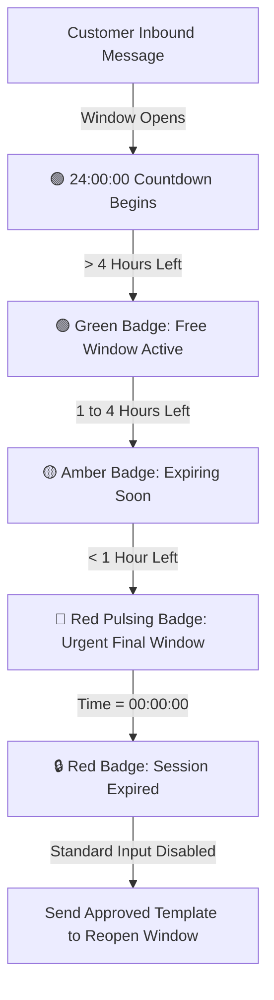

# ⏳ 24-Hour Free Service Window Countdown & WABA Savings Tracker

A complete technical and operational guide to the **24-Hour Free Service Window Countdown** and **WABA Cost Savings Tracker** in **Whatsapp Wiz**.

---

## 📌 Executive Summary

Under Meta's official WhatsApp Business Platform (WABA) pricing model, messaging costs are heavily determined by **who initiates the conversation** and **when the reply is sent**:

1. **Inbound Message**: When a customer sends a message to the business, Meta opens a **24-Hour Customer Service Window**.
2. **Free Session Replies**: During these 24 hours, the business can send **unlimited freeform messages** (text, images, documents, audio, interactive bot messages) to the customer with **₹0.00 Meta template charges**.
3. **Paid Templates Post-24h**: Once the 24-hour window expires, standard messages are blocked by Meta. The business must re-engage using a pre-approved **Meta Template Message** (Utility/Marketing), incurring charges (approx. ₹0.35 to ₹0.85+ per conversation depending on category and country).

### Why this feature matters to businesses:
* **Real-time Urgency for Agents**: Agents see an active live countdown timer so they prioritize conversations before the free window expires.
* **Direct Proof of ROI**: The **Savings Tracker** calculates and displays exact money saved in Rupees (₹) by resolving chats inside the free window versus paying Meta template fees.

---

## 📊 Meta Pricing & Savings Calculation Model

### 1. Cost Comparison Table (India Market Benchmark)

| Message Type | Within 24-Hour Free Window | Outside 24-Hour Window |
| :--- | :--- | :--- |
| **Standard Text / Media Reply** | **₹0.00 (Free / Unlimited)** | ❌ Blocked by Meta |
| **Chatbot Automated Flows** | **₹0.00 (Free)** | ❌ Blocked by Meta |
| **Utility Template** | Included in session | ~₹0.12 – ₹0.35 per conv. |
| **Marketing Template** | Included in session | ~₹0.78 – ₹0.86 per conv. |
| **Authentication Template (OTP)** | N/A | ~₹0.12 per OTP |

> **Meta Free Tier Bonus**: Meta provides **1,000 Free Service Conversations per month** per WABA account for customer-initiated chats.

### 2. ROI & Savings Formula

$$\text{Estimated Savings (₹)} = \text{Total Free In-Window Messages} \times \text{Average Template Cost (₹0.75)}$$

#### Example Business Case (Medium E-Commerce / Support Team):
* Total monthly incoming customer chats: **3,000**
* Outbound replies sent within 24h: **12,000 messages**
* If sent as paid templates: $12,000 \times ₹0.75 = \mathbf{₹9,000\text{ spent}}$
* With 24h Free Window optimization: **Cost = ₹0.00**
* **Total Business Savings = ₹9,000 / month (₹1,08,000 / year)**

---

## 🎨 Feature 1: Live 24-Hour Free Window Countdown

### Visual States & Color Logic

The countdown displays dynamically in the **Active Chat Header** and **Chat List Sidebar**:



#### 1. Chat Header Badges

* **🟢 Green Badge (`> 4h` remaining)**:
  * **Display**: `⏳ 18h 42m 10s · Free Window Active`
  * **Tooltip**: *"You can send unlimited free text & media messages without Meta template fees."*
  * **Composer State**: Normal messaging fully enabled.

* **🟡 Amber Badge (`1h to 4h` remaining)**:
  * **Display**: `⚠️ 02h 14m 30s · Expiring Soon`
  * **Tooltip**: *"Reply now before the free window closes to avoid paid template charges."*
  * **Composer State**: Displays amber helper hint above input box.

* **🔴 Red Urgent Badge (`< 1h` remaining)**:
  * **Display**: `🚨 00h 42m 15s · Final Window`
  * **Tooltip**: *"Critical: Window expires in less than an hour."*

* **🔒 Expired Badge (`0h 00m` remaining)**:
  * **Display**: `Session expired`
  * **Tooltip**: *"24-hour WhatsApp messaging window expired. Send a template message to resume chatting."*
  * **Composer State**: Freeform typing is locked; 1-click **"Send Template"** drawer opens.

---

## 💰 Feature 2: WABA Cost Savings Tracker

### 1. Dashboard ROI Widget

Positioned prominently in the dashboard overview:
* **Metric 1: Total Cost Saved**: e.g., `₹18,450 Saved` (Highlighted with glowing emerald frosted badge).
* **Metric 2: Free Session Messages Sent**: Count of outbound replies delivered at ₹0.00.
* **Metric 3: Window Resolution Rate**: `%` of customer queries answered within the 24h window (e.g., `94.2%`).
* **Metric 4: Comparison vs Last Month**: `+18% efficiency increase`.

### 2. In-Chat Tooltip Breakdown

Hovering over the 24-hour pill in any open conversation shows:
* **Messages Sent in this Session**: e.g., `5 replies`
* **Direct Money Saved in this Chat**: `₹3.75 saved` ($5 \times ₹0.75$)
* **Session Started**: Time of last customer inbound message.

---

## 🛠 Technical Implementation Guide

### 1. Database Schema Reference

The system relies on the existing Prisma schema:

```prisma
model Conversation {
  id              BigInt    @id @default(autoincrement())
  organizationId  BigInt    @map("organization_id")
  contactId       BigInt    @map("contact_id")
  status          String    @default("open")
  startedAt       DateTime  @default(now()) @map("started_at")
  updatedAt       DateTime  @updatedAt @map("updated_at")
  messages        Message[]
}

model Message {
  id                BigInt    @id @default(autoincrement())
  organizationId    BigInt    @map("organization_id")
  conversationId    BigInt    @map("conversation_id")
  senderType        String    @map("sender_type") // 'customer' | 'agent' | 'bot' | 'user'
  messageType       String    @map("message_type") // 'text' | 'image' | 'template' | etc.
  status            String    @default("sent")
  createdAt         DateTime  @default(now()) @map("created_at")
}
```

### 2. Frontend Window Computation (`frontend/app/(app)/inbox/page.tsx`)

```typescript
// 1. Determine the latest inbound timestamp
const lastCustomerMessageTime = useMemo(() => {
  const customerMessages = messages.filter(
    (m) => m.senderType === "customer" || m.senderType === "user"
  );
  if (customerMessages.length === 0) return null;
  const latest = customerMessages[customerMessages.length - 1];
  return new Date(latest.createdAt || latest.sentAt).getTime();
}, [messages]);

// 2. Real-time countdown interval (Ticks every 1000ms)
useEffect(() => {
  const tick = () => {
    if (!lastCustomerMessageTime) {
      setWindowSecondsLeft(0);
      return;
    }
    const elapsedSeconds = Math.floor((Date.now() - lastCustomerMessageTime) / 1000);
    const remaining = 24 * 3600 - elapsedSeconds;
    setWindowSecondsLeft(remaining > 0 ? remaining : 0);
  };

  tick();
  const timer = setInterval(tick, 1000);
  return () => clearInterval(timer);
}, [lastCustomerMessageTime]);

// 3. Format seconds into HH:MM:SS
const formatCountdown = (secs: number) => {
  const h = Math.floor(secs / 3600);
  const m = Math.floor((secs % 3600) / 60);
  const s = secs % 60;
  return `${String(h).padStart(2, "0")}:${String(m).padStart(2, "0")}:${String(s).padStart(2, "0")}`;
};
```

### 3. Backend Savings Aggregator (`backend/src/reports/reports.service.ts`)

```typescript
async dashboard(organizationId: number) {
  const orgId = BigInt(organizationId);
  
  // Fetch messages with senderType and messageType
  const messages = await this.prisma.message.findMany({
    where: { organizationId: orgId },
    select: { senderType: true, messageType: true, createdAt: true, status: true },
  });

  // Outbound non-template messages sent within active sessions
  const freeSessionReplies = messages.filter(
    (m) => m.senderType !== 'customer' && m.messageType !== 'template' && m.status !== 'failed'
  ).length;

  const paidTemplates = messages.filter(
    (m) => m.messageType === 'template' && m.status !== 'failed'
  ).length;

  const AVG_TEMPLATE_COST_INR = 0.75; // Standard benchmark rate
  const estimatedSavingsINR = Math.round(freeSessionReplies * AVG_TEMPLATE_COST_INR);
  const efficiencyRate = freeSessionReplies + paidTemplates > 0
    ? Math.round((freeSessionReplies / (freeSessionReplies + paidTemplates)) * 100)
    : 100;

  return {
    kpis: {
      // ...other KPIs
      freeSessionReplies,
      paidTemplates,
      estimatedSavingsINR,
      efficiencyRate,
    }
  };
}
```

---

## ⚡ Operational Best Practices for Agents

1. **Sort by Window Expiry**: Check chats with amber (`🟡 < 4h`) or red (`🔴 < 1h`) badges first to respond before the free session ends.
2. **Automate with Bots**: Publish interactive bots with quick buttons (`Contact Us`, `Location`, `FAQ`). When a customer interacts, the 24-hour window refreshes automatically.
3. **Template Fallback**: If the window expires, use a pre-approved **Utility** template rather than a **Marketing** template to minimize the Meta per-conversation fee.

---

## 📁 Related Files

- **Inbox Interface & Countdown**: [`frontend/app/(app)/inbox/page.tsx`](file:///d:/waba%206-oct-2026/working-project2/waba-work-updated%20googledrive/waba-work-updated/frontend/app/(app)/inbox/page.tsx)
- **Dashboard & Savings Card**: [`frontend/app/(app)/page.tsx`](file:///d:/waba%206-oct-2026/working-project2/waba-work-updated%20googledrive/waba-work-updated/frontend/app/(app)/page.tsx)
- **Backend Analytics Engine**: [`backend/src/reports/reports.service.ts`](file:///d:/waba%206-oct-2026/working-project2/waba-work-updated%20googledrive/waba-work-updated/backend/src/reports/reports.service.ts)
- **Database Schema**: [`backend/prisma/schema.prisma`](file:///d:/waba%206-oct-2026/working-project2/waba-work-updated%20googledrive/waba-work-updated/backend/prisma/schema.prisma)

---

*Documented by Talelight Media Pvt. Ltd. for Whatsapp Wiz Platform.*
